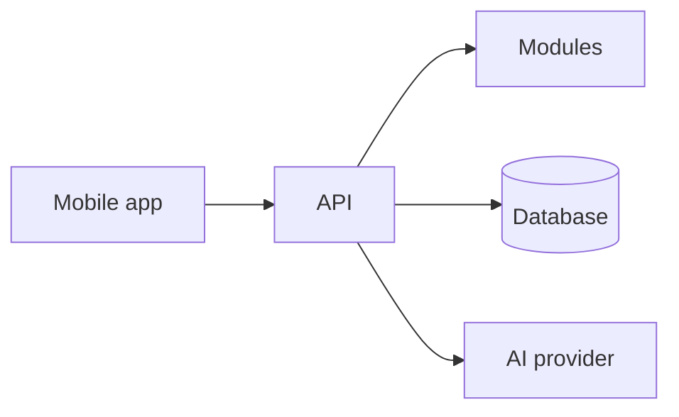

# HOAsecurityplus

A neighborhood security and community app that stays on the community’s own hardware, with a chat-first phone app in front of it.

## The problem

An HOA has to know who is at the gate, what the cameras saw, and what the rules say, without turning neighbor messages, guest details, and household records into something an AI can read. The same tool also has to serve the everyday community: neighbors, documents, a map, and a record of who changed what.

## Key features

- **Roles and permissions.** Each power is its own switch. The server checks it on every request. Members are scoped to their own home.
- **Cameras and security notices.** A local vision worker records camera events. Unrecognized people and vehicles can raise a notice in the Security chat.
- **Gate visits and guests.** Hosts invite guests, with a visit log, check-in, and check-out. Members can use an optional card or tag. The gate does not enroll member faces.
- **Neighbors.** Direct chats and groups. A private chat is visible only to the people in it.
- **Map.** Homes and cameras on a map served from local tiles.
- **Documents.** Upload community documents and ask questions. Answers come from those documents, and the assistant says when nothing matches.
- **Audit logs.** Admin actions are recorded and can be reviewed. The stored row keeps identifiers. Guest details and private message text stay out of it.
- **AI chat and search.** English and Spanish. The assistant answers from documents, allowed community posts, and the tools the person’s role permits.

## Privacy by design

Some data is kept off the model on purpose.

Direct messages, notice threads, and private groups are dropped before a prompt is built. A private group is included only when that group’s admin opts in, and only for a member who can already open it. Message text is added when the question is about chats. A document or schedule question stays free of it.

`NEVER_TO_AI` is a fixed blocklist on the chats that do get through. It strips mute status, group photo details, and read receipts so those fields are never copied into the prompt.

Guest details and private message text are also kept out of model prompts, the audit log, and the document search index. A text that looks like a send or a group change, but does not match a known command, gets a fixed help reply and is not forwarded to the model.

The assistant can propose a change. Nothing is sent or edited until the person confirms, and the server checks the role again. The API is the control, including when the app hides a button.

## Architecture

The phone app talks only to the API. The API reads and writes the database, runs the product modules, and calls a local AI provider on the same machine. A separate vision worker reports camera events to the API.

More detail: [docs/architecture.md](docs/architecture.md).

## Tech stack

- **API:** Python 3.11, FastAPI, PostgreSQL 16
- **AI:** a local model server on the community machine, plus a local document index for search
- **Mobile:** Expo / React Native and TypeScript, for iPhone and web
- **Cameras:** a separate vision service beside the API
- **Run:** Docker Compose on the community’s own machine

## Engineering quality

- **CI.** GitHub Actions runs two jobs on every push and pull request: backend tests, and a mobile build.
- **Backend tests.** The Python 3.11 suite runs against an empty PostgreSQL 16 service.
- **Mobile build.** The type check must stay at zero errors, then the iOS bundle is exported.
- **Type check.** Mobile type errors were brought to zero. CI fails if any return.
- **Container.** The API image runs as a non-root user, with no development auto-reload.
- **Dependencies.** Backend library versions are pinned.
- **CORS.** Browser origins are an explicit list. A wildcard origin is ignored. Local and private-network addresses are allowed for development.
- **Settings.** Saving community settings is admin-only on the server. Sensitive setup actions, including plate recognition and backup status, are admin-only as well.

## Status

Pre-launch. No production users. The private repository describes a working local install. HTTPS waits on a first deployment.

## My role

My role: sole architect and developer.

## Contact

[github.com/erastellius](https://github.com/erastellius)

## Source

This repository is a public description only. The source code is private and available for review on request. See [SOURCE.md](SOURCE.md).
