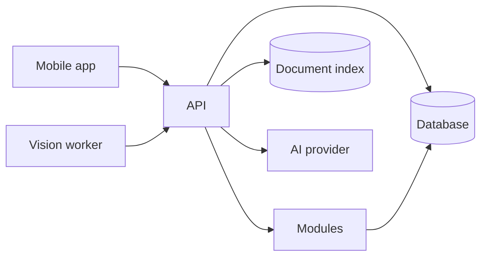

# Architecture

HOAsecurityplus is an edge system for one community. The database, documents, photos, and the language model stay on that community’s machine. The phone app is a client. The API holds the system of record.

## Pieces

| Piece | Role |
| --- | --- |
| Mobile app | Expo / React Native client for iPhone and web. Chat is the main screen. Other work opens from there: homes, guests, documents, the map, neighbors, and settings. |
| API | Python 3.11 FastAPI service. Login, roles, documents, guests, visits, cameras, audit, and settings live here. |
| Modules | Licensed add-ons mounted by the API. Messaging (neighbor chats) and Events (community events, with groups and tasks) are the two modules. Each module owns its routes and its tables. A module answers only when the license includes it. |
| Database | PostgreSQL 16. People, homes, visits, documents, settings, messages, and audit rows. |
| Document index | A local vector index beside the database, used to search uploaded community documents. Retrieval mixes that index with text search. |
| AI provider | A local model server on the same machine. The API calls it for answers and, when a matcher is unsure, for a yes-or-no intent check. The intent check does not receive chat identifiers. |
| Vision worker | A separate service that reads cameras on the local network and posts events to the API. It authenticates with a service credential. |

## How a request moves

1. The app sends the call to the API with the person’s login.
2. The API checks the login, then the specific permission for that action. The app may hide a control. The decision is on the server.
3. Reads and writes go to PostgreSQL. Document questions also consult the local index.
4. If the question needs the model, the API builds a narrow prompt and calls the local AI provider.
5. A write that the assistant proposed is stored only after the person confirms. The server checks the same rules again at confirm time.

Camera frames stay with the vision worker. It sends the API the event it concluded.

## What the model is allowed to see

The filter runs in the API, before the provider is called.

- Direct messages, notice threads, and private groups are omitted. A private group is eligible only after its admin opts in, and only for a member of that group.
- Groups that exist only as admin settings are omitted even if a flag is set.
- Message text is attached only when the question is about messages. A document or schedule question does not receive it.
- `NEVER_TO_AI` then drops mute status, group photo details, and read receipts from any conversation that remains.
- Guest details and private message text are also withheld from prompts, from audit text, and from the document index.
- A near-miss send or group command gets a fixed help line. It is not translated and it is not given to the model.
- Follow-up questions are rewritten from the asking person’s own recent searches, held in memory for a short window. That rewrite does not use guests or private messages. Permissions apply to the rewritten question.

Community and Security posts can be used, and only the lines the asker is allowed to see. A question that names a private chat gets a refusal.

## Access control

Roles are a set of switches. Admin is one role among them, and each power is granted on its own. Built-in use includes an admin and a member scoped to their own home. Guests are a narrower track: invite, visit, and a deny-by-default set of actions.

Saving community settings requires an admin on the server. Plate recognition, backup status, and the guest-photo cleanup preview are admin-only. Plate recognition stays off until an admin turns it on with a board-approval date.

Private chats stay inside their membership. An admin who is not a member does not receive the messages, the title, or the photos. Joining later does not reveal the history from before the join. A missing, hidden, or forbidden chat is answered the same way, so the response does not reveal that the chat exists.

Audit rows record the action and identifiers. People who can view the audit see who did it. The row does not store guest details or private message text.

## What stays on the machine

PostgreSQL is published on the local machine only. Map tiles and address lookup read local files. The model runs locally. Nightly backups are written on that machine and are encrypted when the backup key is present.

Mail is the deliberate exception. If an admin configures an external mail server, messages can leave the machine. With no server configured, nothing is sent.

## Honest limits

There is no production HTTPS yet. That waits on a real deployment. Push notifications are not active. People see notices inside the app, and by email only when mail is configured. There are no production users.
